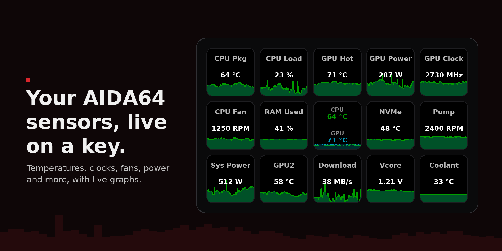

# Aida64SD: AIDA64 sensors on the Stream Deck



Live [AIDA64](https://www.aida64.com) sensor readings (temperatures,
voltages, fan speeds, power, clocks, usage, throughput) on an Elgato Stream
Deck, as graphs, text, or both. Adapted from the
[hwinfo-streamdeck](https://github.com/moeilijk/hwinfo-streamdeck) plugin.

Not affiliated with FinalWire (the makers of AIDA64), Elgato, or the
hwinfo-streamdeck authors.

## Requirements

- Windows 10 or later
- AIDA64 Extreme, Engineer or Business, with shared memory enabled
- Stream Deck software 6.9 or later

## Install

1. In AIDA64, enable *File > Preferences > Hardware Monitoring > External
   Applications > Enable shared memory*. AIDA64 must be running for the
   plugin to show readings.
2. Download `com.poizenjam.aida64sd.streamDeckPlugin` from the
   [Releases](https://github.com/poizenjam/aida64sd/releases) page and
   double-click it.

## Quick start

1. Drag a **Settings** key onto your deck. Its Property Inspector shows
   whether AIDA64 is connected and sets the refresh rate for every key.
2. Drag a **Sensor** key onto your deck and pick a reading. It updates at the
   refresh rate.
3. Add Composite, Derived or Dial keys as you like.

## Actions

- **Sensor**: one reading as a graph, text, or both. Per-key colours,
  Min/Max scale or auto range, format string, divisor and graph unit, and
  per-key thresholds. Each key can opt out of individual global thresholds.
- **Composite**: up to four readings on one key, each with its own colour and
  graph, or as text only.
- **Derived**: a new value from 2 to 8 readings (sum, average, max, min,
  delta, percent).
- **Dial Carousel**: cycle readings on a Stream Deck+ dial, with threshold
  indicators. Turn to change page, press for an overview of all pages,
  touch to snooze an active threshold.
- **Settings**: the key shows the current refresh interval, with "auto"
  underneath while it follows AIDA64. Its Property Inspector holds:
  - **Refresh Rate**: 250 ms to 10 s, or Auto (INI), which follows the
    sensor update rate AIDA64 saves in AIDA64.INI. The INI path and rate key
    can be overridden.
  - **Global Thresholds**: shared threshold rules that apply to every key
    showing that reading type, with hysteresis, cooldown and snooze.
  - **Status**: AIDA64 connection, current rate and installed version.

Thresholds recolour a key and show alert text when a reading crosses a
limit.

## Troubleshooting

- **Keys show "AIDA64 not detected".** AIDA64 is closed or shared memory
  is off (see Install). The plugin reconnects on its own once AIDA64 is
  back, and the Settings key's Property Inspector shows the connection
  status. Keys showing the plain key art without that text have no reading
  chosen yet.
- **Auto (INI) doesn't follow AIDA64.** The Settings Property Inspector
  says why under Refresh Rate, for example that AIDA64.INI wasn't found. Set
  the INI path there and press Refresh. AIDA64 writes the INI when it
  closes, so a rate changed in AIDA64 is picked up after AIDA64 restarts.
- **Keys stay blank after installing.** The exes are not code-signed, and
  Windows SmartScreen or antivirus software sometimes blocks or quarantines
  Go programs. Check Windows Security's protection history. Release files
  are virus-scanned before publishing.

## Building from source

On Windows, with Go installed (`winget install GoLang.Go`):

```powershell
powershell -ExecutionPolicy Bypass -File .\build.ps1 -Install
```

This builds the plugin and installs it into Stream Deck. Building the
sensor bridge needs a C compiler; without one, `build.ps1` uses the
`aida64-bridge.exe` attached to the matching release. Linux/WSL
cross-compiling, tests, architecture and the release process are in
[docs/DEVELOPMENT.md](docs/DEVELOPMENT.md).

## License and credits

Aida64SD is released under the GNU General Public License v3 (see
`LICENSE`).

It is a modified version of
[hwinfo-streamdeck](https://github.com/moeilijk/hwinfo-streamdeck), also
GPL v3, created by [Shayne Sweeney](https://github.com/shayne) and
maintained by [moeilijk](https://github.com/moeilijk), who placed it under
GPL v3 with Shayne's permission. Thanks to both. The process layout, action
model, thresholds and Property Inspector structure come from
hwinfo-streamdeck. New in this project: the AIDA64 backend and reading
model, auto refresh from AIDA64.INI, recovery from a stuck bridge, auto
range, and the icons and artwork. Adapted by PoizenJam in 2026; changes are
recorded in `CHANGELOG.md` and the git history.

The bundled font is DejaVu Sans Bold, under the
[DejaVu Fonts license](https://dejavu-fonts.github.io/License.html).
